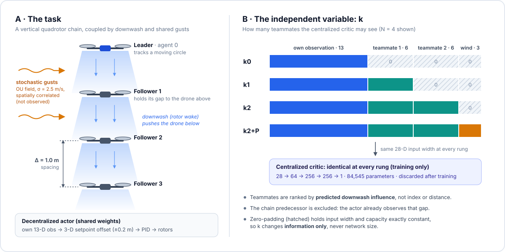
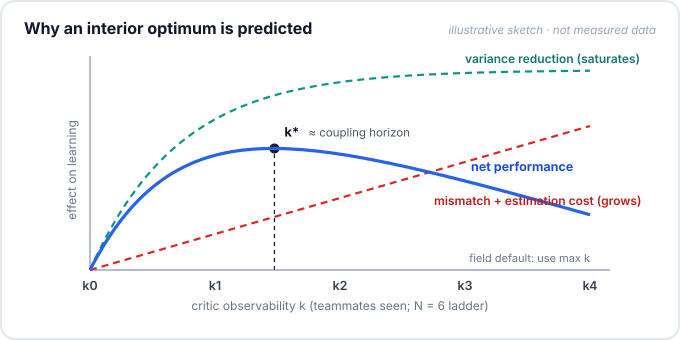
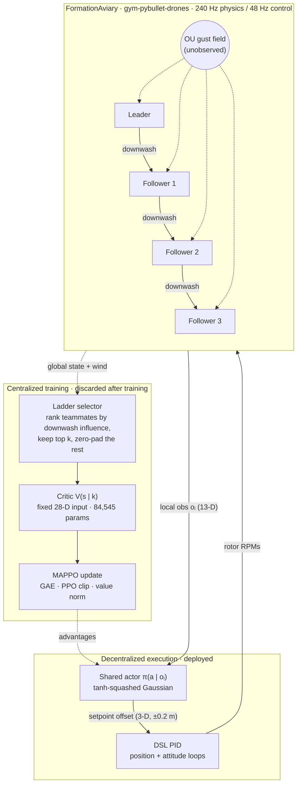
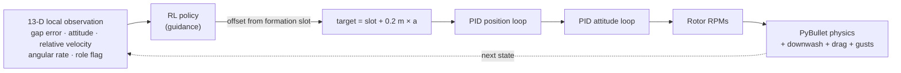
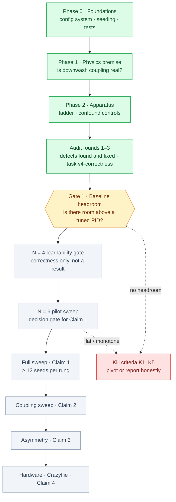
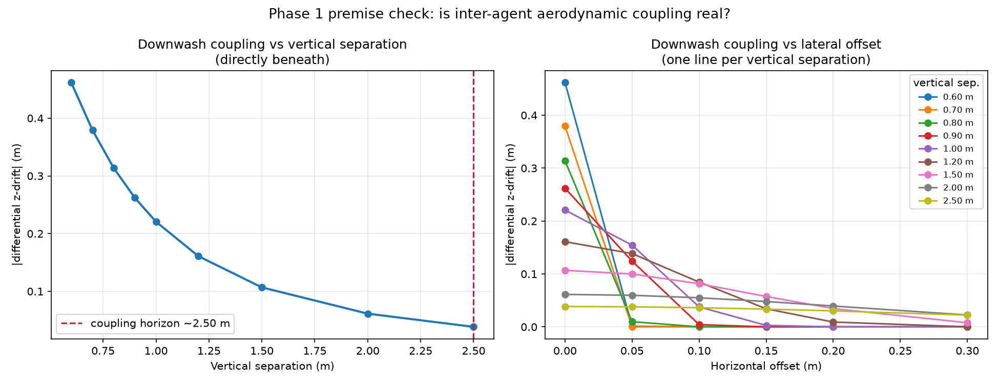

<div align="center">

# Swarm CTDE: How Much Should a Centralized Critic See?

**A controlled study of critic observability in multi-agent reinforcement learning,<br>
on quadrotors that physically interact through aerodynamic downwash.**

[](https://github.com/BahaaIbrahimK/swarm-ctde/actions/workflows/tests.yml)


</div>

---

Centralized Training with Decentralized Execution (CTDE) is the dominant recipe in
cooperative multi-agent RL: a **critic** that sees global information trains a set of
**actors** that each see only local information. The critic is discarded after
training, so the field habitually gives it *everything*. The assumption is that
more critic information is never harmful.

This project tests that assumption directly. It treats the critic's information set
as a **controlled independent variable `k`** (the number of teammates the critic
may observe) and sweeps it on a physically coupled system: a vertical chain of
Crazyflie-class quadrotors holding formation under rotor downwash and stochastic
gusts. The hypothesis is that performance peaks at an **interior** `k`, near the
range where teammates are aerodynamically relevant, rather than at the maximum.

<p align="center">
  
</p>

## Contents

- [Research question and claims](#research-question-and-claims)
- [System architecture](#system-architecture)
- [Experimental design](#experimental-design)
- [Research pipeline](#research-pipeline)
- [Current status](#current-status)
- [Methodological safeguards](#methodological-safeguards)
- [Getting started](#getting-started)
- [Repository layout](#repository-layout)
- [Documentation](#documentation)
- [Author](#author)

---

## Research question and claims

> **Is maximal critic observability actually optimal, or does a centralized critic
> have an interior information optimum on physically coupled multi-robot control?**

| # | Claim | Opposite outcome that would falsify it |
|---|---|---|
| **1** | **Observability optimum.** Performance vs `k` is non-monotonic, with an interior maximum under a fixed sample budget. | Performance is monotone in `k`; maximal centralization is optimal. |
| **2** | **The optimum tracks physical coupling.** As spacing tightens and downwash grows, `k*` moves toward more centralization. | `k*` is constant or moves unpredictably. |
| **3** | **Role-conditional observability.** In role-asymmetric teams, uniform critic input is dominated by role-conditioned input. | Uniform centralization is fine. |
| **4** | **Transfer degradation** *(hardware, conditional).* Sim-to-real loss grows with training-time critic observability. | Benefit transfers proportionally. |

Kill criteria for each claim were committed **before** any results were collected.
See [`PROJECT_CHARTER.md`](PROJECT_CHARTER.md) §3.

### Why an interior optimum is expected

As `k` grows, two opposing effects act on learning:

<p align="center">
  
</p>

- **Variance reduction (saturates).** A critic that sees the drone blowing air on
  you can explain away a sudden dip instead of blaming the action. Once the
  aerodynamically relevant teammates are visible, further teammates add little.
- **Mismatch and estimation cost (grows).** Information the actor can never
  observe becomes noise in its learning signal. A wider critic input also needs more
  data to fit under a fixed budget.

A saturating gain minus a growing cost peaks in the middle. The mechanism also
predicts **where**: near the measured **coupling horizon**.

---

## System architecture

### Training vs. execution



### The three-layer control stack

The policy works at the **guidance** level, which is how deployed drone stacks are
built. Direct rotor control was tried first (task `v1-raw4d`) and proved unlearnable
from scratch.



| | |
|---|---|
| **Agents** | N = 4 (correctness gate) and N = 6 (main study), vertical chain, Δ = 1.0 m |
| **Episode** | 15 s = 720 control steps at 48 Hz; terminates on crash or collision |
| **Observation** | 13-D local, no wind and no teammate state |
| **Action** | 3-D position offset in [−1, 1] × 0.2 m, tracked by a DSL PID |
| **Reward** | survival bonus − 10·(lateral error)² − (vertical error)², time-scaled crash cost |
| **Disturbance** | Ornstein–Uhlenbeck gust field, σ = 2.5 m/s per component, spatially correlated |
| **Learner** | MAPPO, shared actor, hyperparameters fixed across every rung |

---

## Experimental design

### The observability ladder

| Rung | Critic sees | Live input dims (N = 4) |
|---|---|---|
| `k0` | own observation only (independent learner) | 13 |
| `k1` | + the most-coupled informative teammate | 13 + 6 |
| `k2` | + all informative teammates | 13 + 12 |
| `k2+P` | + privileged simulator state (wind/gust vector) | 13 + 12 + 3 |

For N = 6 the ladder is `k0 … k4, k4+P`, which gives three interior points.
Each teammate contributes relative position and relative velocity (6-D).

### Confound controls

The comparison is only meaningful if `k` changes **information** and nothing else:

1. **Byte-identical actor** at every rung. Only the critic's input content changes.
2. **Exactly equal critic capacity.** Every rung receives the same zero-padded 28-D
   input and builds the same 84,545-parameter network. This is verified on the real
   learners the experiment constructs, not on test doubles.
3. **Physically ordered teammates.** Teammates are ranked by *predicted downwash
   influence*, not by agent index or Euclidean distance. A drone 0.6 m above but
   10 cm off-axis exerts ~0 N, so Euclidean order would corrupt the ladder.
4. **No redundant slots.** The chain predecessor is excluded because the actor
   already observes that gap. Without this, `k1` would add zero information for
   some agents and a different amount for others.
5. **Identical sample budget and hyperparameters**, tuned at the maximal rung
   (in favour of the practice being challenged).
6. **Common random numbers.** Every policy, rung and baseline is evaluated on the
   same episode seeds (from 900000).

---

## Research pipeline

Every phase ends in a gate. Later phases do not start until the earlier gate passes.



---

## Current status

| | |
|---|---|
| **Task version** | `v4-correctness` |
| **Test suite** | 100 tests, including end-to-end tests through the real environment |
| **Valid learning results** | **None yet.** Earlier pilot results were invalidated by audit and are archived as evidence only |
| **Open decision** | Gate 1: how to create headroom above a well-tuned classical baseline |

### Phase 1: the physics premise holds

The paper depends on one physical assumption: downwash creates enough inter-agent
coupling for a teammate-aware critic to have something real to explain. This was
tested before any learning code was written.

<p align="center">
  
</p>

The lower drone's differential drift falls from **≈ 0.46 m at 0.6 m** separation to
**≈ 0.04 m at 2.5 m**, a ~12× contrast across the useful range. It collapses within
5–15 cm of lateral offset. Coupling is strong, local and **anisotropic**, which is
why teammates are ranked by predicted influence rather than by distance.

### Gate 1: is there headroom above a classical controller?

Before spending compute on the ladder sweep, the classical baseline was completed
and tuned (100 common episodes, σ = 2.5):

| Controller | Return | RMS error, completed episodes | Crashes | Paired Δ return |
|---|---|---|---|---|
| **Feedforward PID (zero residual)** | 593.3 ± 320.5 | 9.76 cm | 4 / 100 | — |
| PD (0.1, 0.3) | 595.6 | 8.97 cm | 5 / 100 | +2.3 ± 37.6 |
| P gain 0.1 | 555.1 | 9.73 cm | 6 / 100 | −38.2 ± 57.6 |

A well-tuned feedforward PID is close to optimal at the current settings. With
little headroom, a null result from the sweep would be uninterpretable. The leading
option is to make the task harder: tighter spacing, stronger coupling or larger
gusts. That gives `k` something to act on. The full analysis is in
[`HANDOFF.md`](HANDOFF.md).

---

## Methodological safeguards

Three audit rounds found defects that **did not crash anything** but would each
have produced a plausible, wrong result. All are fixed and pinned by regression
tests. The lessons shaped how this codebase is tested:

| Defect class | Example | Safeguard now in place |
|---|---|---|
| Wrong learning machinery | GAE read `dones[t+1]` and ran through episode resets; the crash penalty was dead code because of call order | Tests go through the public path the experiment uses ([`tests/test_correctness.py`](tests/test_correctness.py)) |
| Correct fixes never wired in | Padded critic input existed, but MAPPO never called it | Tests instantiate the real `Trainer` / `MAPPO` / `FormationAviary` ([`tests/test_wiring.py`](tests/test_wiring.py)) |
| Correct runs, corrupted report | An aggregator averaged across Claim 2's own independent variable | Tests check what reaches the final table ([`tests/test_reporting.py`](tests/test_reporting.py)) |
| Under-sampled calibration | Gust strength "0% crashes" on 24 episodes turned out to be 4/100 | ≥ 100 episodes and a failure rate declared in advance |
| Handicapped baseline | The PID lacked a velocity feedforward term, so RL looked worse than it was | The baseline is completed and tuned before the learner is diagnosed |

Other conventions:

- **Settings live in versioned YAML** (`configs/`), never in argparse.
- **Each run saves its config, git commit and task version**, and results from
  different task versions are never pooled.
- **Named RNG streams** (`make_rng(seed, stream=...)`) so subsystems cannot perturb
  each other. Global `np.random` is never used.
- **Report physical metrics next to return.** Return is bimodal (crash vs no crash),
  so tracking error in centimetres, conditional on completion, is reported next to
  crash probability.

---

## Getting started

**Requirements:** Linux, macOS or WSL2 · **Python 3.12 exactly** · a C/C++ toolchain
(`build-essential`). CPU only; no GPU is used.

### One-command setup

```bash
git clone https://github.com/BahaaIbrahimK/swarm-ctde.git ~/projects/swarm-ctde
cd ~/projects/swarm-ctde
bash setup_new_machine.sh      # venv, CPU PyTorch, pinned deps, then the full test suite
```

### Manual setup

```bash
python3.12 -m venv .venv && source .venv/bin/activate
pip install --upgrade pip
pip install --index-url https://download.pytorch.org/whl/cpu torch==2.13.0
pip install -r requirements.cpu.txt     # includes gym-pybullet-drones at a pinned commit
python -m pytest tests/ -q              # expect: 100 passed
```

> `gym-pybullet-drones` is **not on PyPI**. It installs from GitHub at a pinned
> commit, because a different commit means different physics. Python 3.13+ breaks
> parts of the scientific stack. See [`SETUP_NEW_MACHINE.md`](SETUP_NEW_MACHINE.md).

### Running the stages

| Stage | Command | Guide |
|---|---|---|
| Phase 1: downwash probe | `python scripts/run_downwash_probe.py` | [`commands/03`](commands/03_phase1_downwash.md) |
| Phase 2: inspect the ladder | `python scripts/inspect_ladder.py` | [`commands/04`](commands/04_phase2_apparatus.md) |
| Task health checks | `python scripts/verify_task_fixes.py` | [`commands/06`](commands/06_task_health.md) |
| Learnability gate (N = 4) | `python scripts/check_learning.py --steps 30000 --seeds 3 --rung k1` | [`HANDOFF.md`](HANDOFF.md) |
| Pilot sweep | `python scripts/run_overnight.py --stage1-steps 300000 --stage2-steps 400000` | [`commands/05`](commands/05_phase3_pilot.md) |
| Figures | `python figures/plot_sweep.py <results-dir>` | [`figures/README.md`](figures/README.md) |

Set `OMP_NUM_THREADS=1 MKL_NUM_THREADS=1` for multi-process sweeps.

---

## Repository layout

```
swarm-ctde/
├── PROJECT_CHARTER.md        research plan: gap, claims, kill criteria, status log
├── HANDOFF.md                where the work stands and the open decision
├── SETUP_NEW_MACHINE.md      environment, pinned versions, known failure modes
├── configs/                  versioned experiment settings (YAML with inheritance)
├── src/ctde/
│   ├── envs/                 FormationAviary task · downwash coupling model
│   ├── models/               observability ladder · actor / critic networks
│   ├── training/             MAPPO · rollout buffer + GAE · trainer · sweep
│   ├── physics/              Phase 1 downwash measurement rig
│   ├── baselines.py          PID / P / PD reference controllers
│   ├── metrics.py            physical metrics, error amplification along the chain
│   └── utils/                config loading · seeding · run naming + manifests
├── scripts/                  entry points for every stage
├── tests/                    100 tests, including end-to-end through the real env
├── figures/                  plotting code for the paper figures
├── commands/                 numbered, copy-paste terminal guides per stage
└── docs/                     experiment definition, audits, design notes, diagrams
```

See [`docs/ARCHITECTURE.md`](docs/ARCHITECTURE.md) for the module map, the training
loop and the evaluation protocol.

---

## Documentation

| Document | Contents |
|---|---|
| [`PROJECT_CHARTER.md`](PROJECT_CHARTER.md) | The research plan. §1–§3 give the idea; §S.* is the status log, newest first |
| [`docs/EXPERIMENT_DEFINITION.md`](docs/EXPERIMENT_DEFINITION.md) | Glossary and full definition of the RL problem |
| [`docs/ARCHITECTURE.md`](docs/ARCHITECTURE.md) | Code architecture, training loop, evaluation protocol |
| [`HANDOFF.md`](HANDOFF.md) | Current state, the open decision, pass criteria for the next gate |
| [`docs/review_fixes_2026-09-17.md`](docs/review_fixes_2026-09-17.md) | Most recent audit (Gates 0 and 1) |
| [`docs/audit_2026-09-16.md`](docs/audit_2026-09-16.md) | The three earlier audit rounds |
| [`docs/learnability_v4.md`](docs/learnability_v4.md) | Why training was halted |
| [`docs/downwash_model_notes.md`](docs/downwash_model_notes.md) | Downwash model and its limits |
| [`commands/`](commands/) | Step-by-step terminal guides |

---

## Author

**Bahaa Ibrahim**, King Fahd University of Petroleum & Minerals (KFUPM)

This repository supersedes an earlier prototype,
[`drone-leaderfollower`](https://github.com/BahaaIbrahimK/drone-leaderfollower)
(Ray RLlib, leader-follower CTDE). The current codebase is a ground-up rewrite with
a controlled experimental design.

If you use this code, please cite it with the metadata in
[`CITATION.cff`](CITATION.cff).
