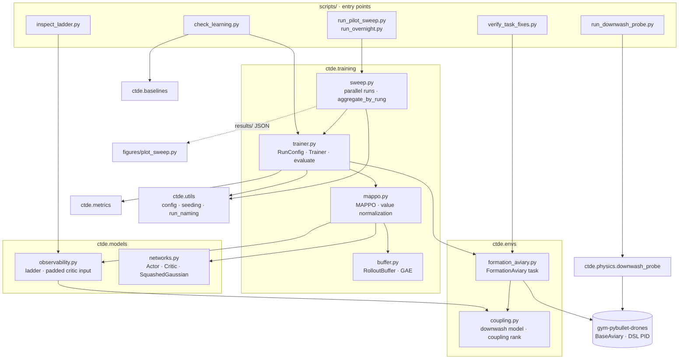
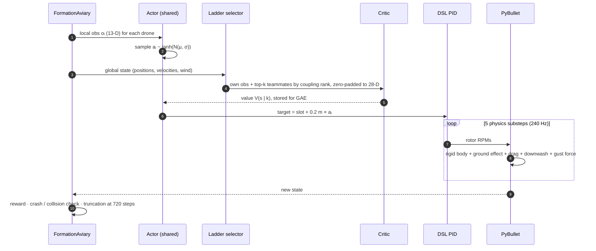
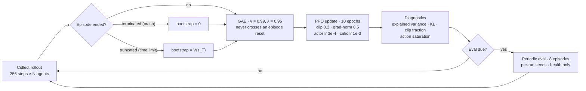
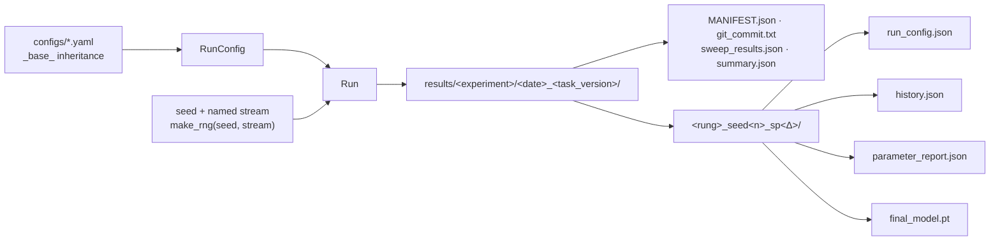

# Architecture

How the code is organised, how one training run flows through it, and how results
are evaluated and recorded. For the research rationale see
[`../PROJECT_CHARTER.md`](../PROJECT_CHARTER.md); for definitions of every term see
[`EXPERIMENT_DEFINITION.md`](EXPERIMENT_DEFINITION.md).

---

## 1. Module map

| Module | Responsibility |
|---|---|
| `envs/formation_aviary.py` | The task: chain references, OU gust field, wind force application, reward, crash/collision detection, termination vs truncation |
| `envs/coupling.py` | Analytical downwash proxy used to **rank** teammates by influence; spacing validity checks |
| `models/observability.py` | Builds the ladder (`k0 … k(N−2)`, `+P`) and the zero-padded critic input |
| `models/networks.py` | Actor (13-D → 3-D, tanh-squashed Gaussian) and fixed-capacity Critic |
| `training/buffer.py` | Rollout storage and GAE with correct terminal/truncation handling |
| `training/mappo.py` | PPO update for the shared actor and the centralized critic |
| `training/trainer.py` | One run: environment, learner, periodic and final evaluation, checkpoints |
| `training/sweep.py` | Many runs across rungs × seeds × spacings, process-parallel, and aggregation |
| `baselines.py` | Zero-residual PID, P and PD reference controllers |
| `metrics.py` | Physical metrics (cm, m), crash and collision rates, error amplification down the chain |
| `utils/` | YAML config inheritance, named RNG streams, run directories and manifests |

---

## 2. One environment step

---

## 3. One training iteration

At the end of training the **final evaluation** runs the deterministic policy on
24 held-out episodes. Those are the reported numbers.

---

## 4. Evaluation protocol

| | Periodic evaluation | Final evaluation |
|---|---|---|
| Purpose | "Is this run healthy?" | The reported number |
| Episodes | 8 | 24 |
| Seeds | per run (`seed × 1000 + 10 000 + i`) | **common to every policy, rung and baseline** (from 900 000) |
| Policy | deterministic | deterministic |
| Reported | never | yes, with physical metrics |

**Common random numbers.** Every condition is scored on the same episodes, so
paired comparisons remove episode-difficulty variance. The **training seed** is the
statistical unit; episodes are nested repeated measures.

**Physical metrics first.** Return is bimodal (crash vs. no crash), so each result
also reports:

- RMS tracking error in cm, **conditional on completion** (crashes would otherwise
  censor it downward)
- crash and collision probability
- lateral error (detects the "sidestep the downwash" exploit)
- error amplification down the chain (string stability)

---

## 5. Reproducibility and provenance

- **The task version is in every result path** (`v4-correctness`), so results from
  different task definitions cannot be pooled by accident.
- **Named RNG streams** isolate subsystems: evaluating more often never changes the
  training environment's gust sequence.
- **Invalid runs are marked, not deleted.** `mark_status()` writes an `INVALID`
  banner with the reason, and the archive is kept as a record of why decisions
  were made.
- **Pinned simulator commit.** `gym-pybullet-drones` is pinned in
  `requirements.cpu.txt`, because a different commit means different physics.
